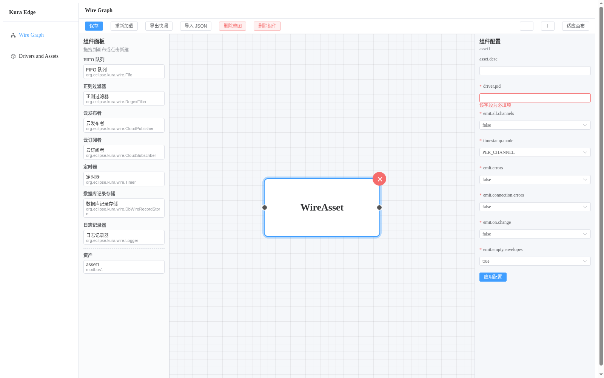
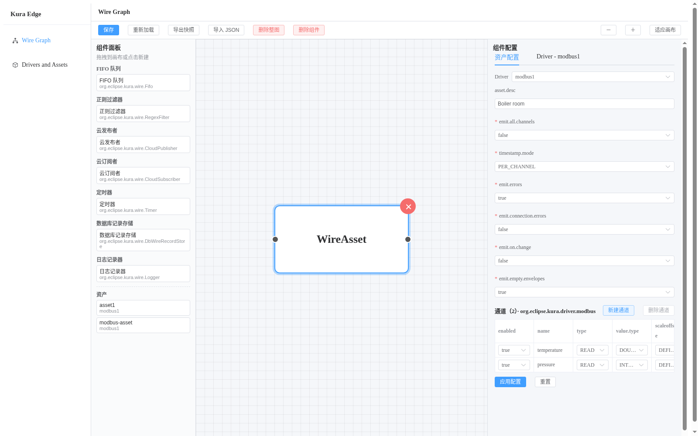
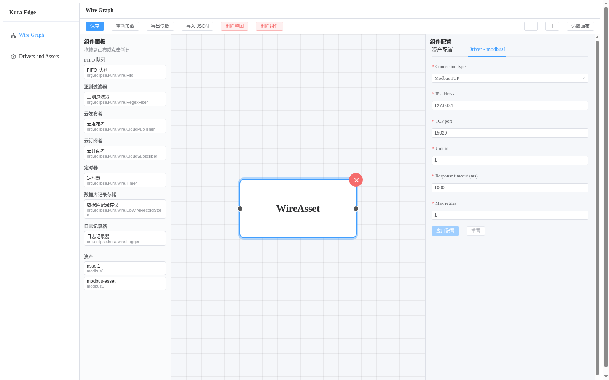

# Drivers and Assets：领域模型、生命周期与 REST 契约

> 目标读者：想知道「资产是什么、什么时候被创建、值和配置存在哪、界面点一下会发什么请求」的人。
> 实现依据是 RFC 002（`.claude/.change/rfc/002-drivers-and-assets.md`）；对照的上游源码位置见各节括注。

---

## 0. 一句话答案

| 问题 | 答案 | 位置 |
|---|---|---|
| Asset 是什么？ | 一个 `WireAsset` 组件实例：`driver.pid` + 一组具名通道 | `kura-edge-components/.../asset/WireAsset.java` |
| Driver 是什么？ | 协议适配器（内置模拟驱动 + Modbus 主站驱动），工厂 PID 分别为 `org.eclipse.kura.driver.simulated` 与 `org.eclipse.kura.driver.modbus` | `kura-edge-components/.../driver/simulated/SimulatedDriverFactory.java`、`.../driver/modbus/ModbusDriverFactory.java` |
| 资产/驱动的配置存在哪？ | 与所有组件一样存在 `component_configuration` 表（属性 JSON，键名与 Kura 快照一致） | `kura-edge-core/.../config/ComponentConfigurationServiceImpl.java` |
| 谁创建资产实例？ | `AssetServiceImpl`（`@PostConstruct` 恢复 + 页面创建时立即建），**不是**线图 | `kura-edge-core/.../asset/AssetServiceImpl.java` |
| 资产能进线图吗？ | 能，`factoryPid = org.eclipse.kura.wire.WireAsset`，与上游一致；进图时复用同一实例 | `WireComponentRegistry#reuseCandidate` |
| 值从哪来？ | 模拟驱动：内存寄存器表（`simulated.register`）；Modbus 驱动：真实从站的线圈/寄存器 | `SimulatedDriver.java`、`ModbusDriver.java` |

---

## 1. 分层落点

```
kura-edge-api        model/channel（Channel/ChannelRecord/ChannelType/ChannelStatus/ScaleOffsetType）
                     model/driver（Driver/ChannelDescriptor）、model/asset（Asset/AssetConfiguration/AssetConstants）
                     model/type（DataType/TypedValues）、engine（DriverFactory/SelfConfiguringComponent）
kura-edge-core       asset（AssetChannelParser/ScaleOffsetApplier/BaseAsset/AssetService）
                     driver（DriverService）、config（DefinitionDefaults）
kura-edge-components asset（WireAsset/WireAssetFactory/WireAssetOcd/RecordFillers/ValueChangeCache）
                     driver/simulated（Simulator 驱动）
                     driver/modbus（官方 Modbus 协议移植：CRC/功能码/TCP 与 RTU-over-TCP/通道编解码）
kura-edge-rest       DriversAssetsService / AssetDataService + 两个 Controller + DTO
frontend             views/DriversAssetsPage + components/drivers/* + stores/driversAssets
```

依赖方向仍是 `api ← core ← components ← rest`（ArchUnit 强制）。

---

## 2. 配置键（兼容契约，禁止改名）

资产的全部通道存在**一张扁平属性表**里（对照 `org.eclipse.kura.asset.provider.AssetConstants`）：

| 键 | 含义 |
|---|---|
| `driver.pid` | 绑定的驱动实例 PID（**必填**） |
| `asset.desc` | 资产描述 |
| `<channel>#+enabled` | 是否启用（默认 true） |
| `<channel>#+name` | 通道展示名（真正的名字取自键前缀） |
| `<channel>#+type` | `READ` / `READ_WRITE` / `WRITE` |
| `<channel>#+value.type` | `BOOLEAN/BYTE_ARRAY/DOUBLE/INTEGER/LONG/FLOAT/STRING` |
| `<channel>#+scaleoffset.type` | `DEFINED_BY_VALUE_TYPE/FLOAT/DOUBLE/INTEGER/LONG` |
| `<channel>#+scale`、`#+offset` | 数值换算（缺省 1.0 / 0.0） |
| `<channel>#+unit` | 单位 |
| `<channel>#+listen` | 是否监听驱动事件（**本轮只存不跑**） |
| `<channel>#<driverParam>` | 驱动自有参数（不带 `+`），模拟驱动是 `simulated.register` |
| `emit.all.channels` / `timestamp.mode` / `emit.errors` / `emit.connection.errors` / `emit.on.change` / `emit.empty.envelopes` | WireAsset 的发射选项 |
| `modbus.object.type` | Modbus 对象：`COIL` / `DISCRETE_INPUT` / `HOLDING_REGISTER` / `INPUT_REGISTER` |
| `modbus.address` | Modbus 起始地址（0–65535） |
| `modbus.register.count` | 寄存器/位数量；缺省按 `+value.type` 推导（FLOAT=2、DOUBLE=4、LONG=2、其余=1） |
| `modbus.data.order` | 多寄存器数值的字节序/字序（`BIG_ENDIAN`/`LITTLE_ENDIAN`/`BIG_ENDIAN_WORD_SWAP`/`LITTLE_ENDIAN_WORD_SWAP`） |

解析规则（`AssetChannelParser`，逐条对标上游）：

- 键在**第一个** `#` 处切分；通道名含 `#/+, `（含空格）或为空 → **整条通道静默丢弃**；
- 缺 `+type` 或 `+value.type` → 该通道静默丢弃；
- `+enabled` 缺键 → true；键存在但不是 `"true"` → false（上游 `parseBoolean` 语义）；
- 绑定/更新时用「基座 AD + 驱动 AD」的**必填默认值**补齐通道缺省参数（`AssetChannelParser#withChannelDefaults`）。

---

## 3. 生命周期（与线图解耦）

```
POST /api/v1/wires/drivers   → DriverServiceImpl#createDriver   → 落库 + 建驱动实例
POST /api/v1/wires/assets    → AssetServiceImpl#createAsset     → 落库 + 建 WireAsset 实例
PUT  /api/v1/wires/assets/{pid} → AssetServiceImpl#updateAsset  → 销毁实例 → 改库 → 重建实例（上游「删掉再建」语义）
DELETE /api/v1/wires/assets/{pid} → 校验线图引用 → 删库 + 销毁实例
```

- `WireAsset` 实现 `SelfConfiguringComponent`（对照上游 `SelfConfiguringComponent`）：**实例由配置掌管**。
  线图挂载同一 PID 时 `WireComponentRegistry` 直接复用已有实例；线图删除时上游会连配置一起删，
  本项目保持一致（所以界面提示「资产在图里，请到线图删除」）。
- 启动时 `AssetServiceImpl#init` / `DriverServiceImpl#init` 会按库里既有配置重建实例（等价于上游 DS 激活）。
- 驱动按 `driver.pid` **惰性绑定**：`BaseAsset` 第一次读写时找驱动并 `connect()`；驱动被重建时下次读会自动换绑。

---

## 4. 读写语义（`BaseAsset` + `WireAsset`）

| 操作 | 规则 |
|---|---|
| `readAllChannels` | 只读启用的 `READ`/`READ_WRITE`；IO 异常整体上抛（REST 500 / `500003`） |
| `read(Set)` | 结果条数 = 请求条数；通道不存在/方向不允许/未启用 → 该条 FAILURE，消息分别是 `Channel not available`、`Channel type not within expected types (READ or READ_WRITE)`、`Channel is not enabled` |
| `write(List)` | 方向不允许的记录标 FAILURE 后继续；驱动内的失败由驱动标在记录上 |
| scale/offset | 仅数值型；`DEFINED_BY_VALUE_TYPE` 按通道类型运算，显式类型先按该类型算再转回通道类型；scale=1 且 offset=0 跳过 |
| 收到信封（`WireAsset.onWireReceive`） | 先读全部可读通道发一个信封，再把信封里**同名且类型严格一致**的记录写回设备（不一致静默忽略，上游语义） |
| 信封属性 | `assetName` + `<ch>` + `<ch>_timestamp`（PER_CHANNEL）+ `<ch>_unit`（非空）+ `<ch>_error`（emit.errors）+ `assetTimestamp`（单时间戳模式）+ `assetError`（同时开 emit.errors 与 emit.connection.errors） |

---

## 5. REST 速查

| 方法 | 路径 | 说明 |
|---|---|---|
| GET | `/api/v1/wires/metadata` | 组件定义 + `driverOCDs` + `driverChannelDescriptors` + `assetChannelDescriptor` |
| GET | `/api/v1/wires/metadata/drivers/factory-pids` | 驱动工厂 PID（New Driver 下拉） |
| GET | `/api/v1/wires/metadata/drivers/channel-descriptors` | 每个驱动实例的通道参数定义 |
| GET | `/api/v1/wires/metadata/assets/channel-descriptor` | 基座通道参数（9 个） |
| GET | `/api/v1/wires/drivers`、`/assets` | 实例列表（资产条目带 `driverPid`/`description`） |
| POST | `/api/v1/wires/drivers` | 建驱动 `{factoryPid,pid,properties?}` |
| POST | `/api/v1/wires/assets` | 建资产 `{pid,driverPid,description?}` |
| GET/PUT | `/api/v1/wires/drivers/{pid}/configuration`、`PUT /api/v1/wires/drivers/{pid}` | 驱动配置读写 |
| GET/PUT | `/api/v1/wires/assets/{pid}/configuration`、`PUT /api/v1/wires/assets/{pid}` | 资产配置读写（PUT 是重建语义） |
| DELETE | `/api/v1/wires/drivers/{pid}`、`/assets/{pid}` | 删除（被引用 → 409 `409003`） |
| GET | `/api/v1/assets/{pid}` | 通道列表 |
| GET | `/api/v1/assets/{pid}/_read` | 读全部（通道名 → 原始值，字节数组 base64） |
| POST | `/api/v1/assets/{pid}/_read` | 读指定通道（带 `status`/`exceptionMessage`） |
| POST | `/api/v1/assets/{pid}/_write` | 写 `{channels:[{name,type,value}]}`，返回写后记录 |

错误码：`400001` 参数、`400003` 配置非法、`404001` 不存在、`409003` 被引用、`500003` 通道 IO 失败。

## 5.1 Modbus 驱动（`org.eclipse.kura.driver.modbus`）

驱动实例配置（OCD）：

| 键 | 默认 | 说明 |
|---|---|---|
| `modbus.connection.type` | `TCP/IP` | `TCP/IP`（MBAP）或 `TCP-RTU`（RTU 帧跑在 TCP 上） |
| `modbus.ip.address` | `127.0.0.1` | 从站/网关地址 |
| `modbus.tcp.port` | `502` | TCP 端口 |
| `modbus.unit.id` | `1` | Modbus unit/slave id |
| `modbus.response.timeout` | `1000` | 连接与响应超时（毫秒） |
| `modbus.max.retries` | `2` | 超时/IO 失败重试次数 |

通道参数见 §2；驱动按通道的 `+value.type` 把寄存器/位解码成对应的 Java 值，写入是逆过程。
单条记录失败只标记该条 `FAILURE`；连接级失败抛 `Driver.ConnectionException`，REST 统一为 `500003`。

## 5.2 Wire Graph 里的资产配置区

选中资产时，右侧配置区显示两个页签（对照上游 `ConfigurationAreaUi`）：

1. **资产配置**：资产级字段（`asset.desc`、`emit.*`）+ `driver.pid` 下拉 + 通道表；Apply 写回图 store，
   随整图保存落库。
2. **Driver - <pid>**：该驱动的 OCD 表单；Apply 调用 `PUT /api/v1/wires/drivers/{pid}`，后端重建驱动实例。

从组件面板把已有资产拖进图时，前端会先读取 `GET /wires/assets/{pid}/configuration`，用已保存的通道和
`driver.pid` 初始化画布组件，避免保存整图时把资产配置冲回默认值。

---

## 6. 本轮明确不做（RFC 002 §6 / RFC 003 §0）

1. `+listen` 驱动事件监听、`emit.on.change` 之外的驱动事件相关行为（配置键与 OCD 已保留）；
2. CSV 通道下载/上传、列显隐弹窗；
3. 真实协议驱动的其余部分：本轮只交付 Modbus TCP / RTU-over-TCP 主站；串口 Modbus、ASCII 帧、
   从站模式、OPC-UA/GPIO 驱动不在本轮（串口需要 OSGi `CommConnection` 或新增本地串口库，无法在 CI 稳定验证）；
4. 资产的 cloudlet / 云发布。

## 7. 界面截图（Wire Graph 资产配置）

改动前（只有扁平 OCD 表单，`driver.pid` 是自由文本，没有通道表/Driver 页签）：



改动后资产页签（资产字段 + driver 下拉 + 通道表）：



改动后 Driver 页签（Modbus 连接选项）：


