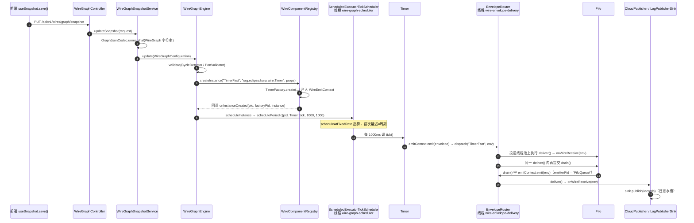

# 导入 `demo-wires-snapshot.json` 后的 Java 运行期代码流程

> 目标读者：想在代码里定位「谁把定时器挂上去的」「定时器怎么把信封递到 FIFO」「FIFO 又是被谁调用的」。
> 本文所有行号以当前工作区代码为准，改动代码后请同步更新。
>
> 例子取自 `frontend/examples/demo-wires-snapshot.json`：

```
y=80   TimerFast（SIMPLE，1 秒）──▶ FifoQueue ──▶ CloudPublisherOut
y=240  TimerTick（SIMPLE，5 秒）──▶ TimerKeyFilter ──▶ LoggerSink
```

---

## 0. 一句话答案（先看这张表）

| 问题 | 类#方法 | 位置 |
|---|---|---|
| 谁把定时任务挂到调度器上？ | `WireGraphEngine#scheduleInstance(String, WireComponent)` | `kura-edge-core/.../engine/WireGraphEngine.java:445` |
| 它是在哪一刻被调用的？ | `WireGraphEngine` 构造器里注册的匿名监听器 `onInstanceCreated(...)` → 组件注册表创建实例后回调 | `WireGraphEngine.java:138-151`（回调在 `WireComponentRegistry.java:229`） |
| 真正调 JDK 定时器的方法是哪个？ | `ScheduledExecutorTickScheduler#schedulePeriodic(...)` → `ScheduledExecutorService.scheduleAtFixedRate(...)` | `ScheduledExecutorTickScheduler.java:53-59` |
| 每次触发执行的业务代码是？ | `Timer#tick()`（以方法引用 `emitter::tick` 交给调度器） | `Timer.java:67`，方法引用在 `WireGraphEngine.java:451` |
| 定时器「触发 FIFO 的哪个方法」？ | 不是 Timer 直接调 FIFO：`Timer#tick()` → 引擎投递 → `EnvelopeRouter#deliver(...)` → **`Fifo#onWireReceive(WireEnvelope)`**，紧接着引擎再异步调 **`Fifo#drain()`** | `EnvelopeRouter.java:73-91`；`Fifo.java:81`、`Fifo.java:107` |
| FIFO 之后谁接着跑？ | `Fifo#drain()` 里的 `emitContext.emit(...)` → `EnvelopeRouter#deliver` → `CloudPublisher#onWireReceive` → `LogPublisherSink#publish` | `CloudPublisher.java:80`、`LogPublisherSink.java:32` |

一张图概括（时序图）：



---

## 1. 阶段 0：从「导入 JSON」到「保存」（前端，不入库）

导入动作只在浏览器里重建画布，**真正让图跑起来的是保存**。

| 步骤 | 代码 | 说明 |
|---|---|---|
| 解析文件 | `frontend/src/api/wireGraphCodec.ts` → `parseSnapshotFile(value)` | 识别 `{configs:[...]}` 形态，交给 `extractGraphSnapshot` |
| 取图与配置 | `extractGraphSnapshot(configs)` | 找 pid = `org.eclipse.kura.wire.graph.WireGraphService` 的条目，取 `WireGraph` STRING 属性 → `JSON.parse` → 图 `{components,wires}`；其余条目摊平为 `pid → 属性表` |
| 重建画布 | `useSnapshot.ts` → `store.loadFromSnapshot(graph, configurationProperties)` | 组件状态里已有 `factoryPid`（`service.factoryPid`）与全部属性 |
| 保存 | `useSnapshot.ts` → `save()` → `toSnapshotConfigurations(...)` → `putSnapshot(configs)` | 装配 `[{pid:WireGraphService, properties:{WireGraph:{type:STRING,value:"<图 JSON 字符串>"}}}, {pid:TimerFast, ...}, ...]`，发 `PUT /api/v1/wires/graph/snapshot` |

> 若导入的是**纯图 JSON**（`demo-graph.json`），配置属性缺失，前端会走 `recoverConfigurations()` 按 pid 调 `POST /configs/by-pids` 向后端补；补不齐的组件在保存前被 `componentsWithoutFactoryPid()` 拦下。

---

## 2. 阶段 1：保存请求的后端处理链（组件实例与路由表在这里诞生）

```
PUT /api/v1/wires/graph/snapshot
└─ WireGraphController#updateSnapshot                        kura-edge-rest/.../controller/WireGraphController.java:79
   └─ WireGraphSnapshotService#updateSnapshot                kura-edge-rest/.../service/WireGraphSnapshotService.java:106
      ├─ 拆 configsByPid，取出 WireGraphService 配置
      ├─ extractWireGraphProperty(...)                       :132  取 WireGraph 字符串（必须是 STRING）
      ├─ GraphJsonCodec#unmarshal(marshalled)                kura-edge-core/.../snapshot/GraphJsonCodec.java:152
      │     · 组件只带 pid + inputPortCount/outputPortCount/position.x/position.y（无业务配置）
      │     · 连线 → MultiportWireConfiguration(emitter, receiver, emitterPort, receiverPort)
      ├─ validateReceivedConfig(config)                      :147  每个组件必须有 service.factoryPid 且工厂已注册
      ├─ mergeReceivedConfigs(graph, configsByPid)           :164  把请求里的组件属性合并进图（含密码占位符还原）
      └─ updateGraphInternal(new WireGraphConfiguration(...)):194
         └─ WireGraphService#update(...)   →  WireGraphEngine#update   WireGraphEngine.java:162
```

`WireGraphEngine#update` 做三件事：

1. `validate(graphConfiguration)`（`WireGraphEngine.java:224`）
   `CycleDetector.hasCycle(...)` → `PortValidator.validate(...)`；失败抛 `TOPOLOGY_CYCLE` / `PORT_MISMATCH`，**一个组件都不会创建**。
2. 与已落库的旧图 diff（`loadGraph()`，`:355`），分成 `toCreate` / `retained` / `toDelete`。
3. `apply(...)`（`WireGraphEngine.java:250`），顺序是：

| 顺序 | 代码 | 效果 |
|---|---|---|
| ① 创建新组件实例 | `registry.createInstance(pid, factoryPid, instanceProperties(...))` `:262` | 逐个调用 `TimerFactory#create` / `FifoFactory#create` / `LogPublisherSink` 等，注入 `WireEmitContext`；**每创建一个就同步回调监听器 → 这里挂上定时器** |
| ② 销毁被删组件 | `registry.destroyInstance(pid)` `:270` | 回调里取消该 pid 的排程 |
| ③ 刷新保留组件 | `propertiesChanged(...)` → `rebuildInstance(...)` `:527` | 运行期属性变了就**销毁 + 重建**（Timer 的间隔固化在构造期），只改坐标不会重建 |
| ④ 写组件配置 | `configurationService.createFactoryConfiguration / updateConfiguration` | 落库（H2 / PostgreSQL） |
| ⑤ 存整图快照 | `snapshotStore.save(WireGraphConstants.WIRE_GRAPH_SERVICE_PID, codec.marshal(newGraph))` `:302` | 图 JSON 落库，重启后由 `loadGraph()` 读回 |
| ⑥ 更新缓存 + 重建路由 | `updateGraphCache(newGraph)` → `refreshRoutes()` `:303-306` | `EnvelopeRouter#refresh` 按 `emitter` 建「发射端 → 出边列表」表 |

> **为什么 ⑥ 要写两次 `refreshRoutes()`？**
> ① 里创建实例时触发 `onInstanceCreated` 也会调一次 `refreshRoutes()`，但那一刻 `currentGraph` 还是旧图（首次导入是空图），
> 所以出边表是空的。必须等 `updateGraphCache(newGraph)` 之后再刷一次，投递才有出边（代码注释见 `WireGraphEngine.java:304-306`）。

---

## 3. 阶段 2：定时任务是「谁」挂上去的（关键问题 1）

### 3.1 挂载调用链

```
WireGraphEngine 构造器（Spring @Autowired，启动时执行一次）
  ├─ registry.setEnvelopeDispatcher(this::dispatch)          WireGraphEngine.java:137
  │     → 把「发射」回调回注给组件注册表（打破 Bean 循环依赖）
  └─ registry.addListener(new WireComponentRegistryListener(){...})   :138
        onInstanceCreated(pid, factoryPid, instance) {        :141
            scheduleInstance(pid, instance);                  :142
            refreshRoutes();                                  :143
        }
        onInstanceDestroyed(pid, factoryPid) {                :147
            tickScheduler.cancel(pid);                        :148
            refreshRoutes();                                  :149
        }

保存请求（阶段 1）里：
WireGraphEngine#apply                                          :259-264
  └─ WireComponentRegistry#createInstance(pid, factoryPid, props)  WireComponentRegistry.java:137
       ├─ TimerFactory#create(pid, props, emitContext)         TimerFactory.java:88
       │     └─ new Timer(pid, new TimerOptions(props), emitContext)
       ├─ instances.put(pid, instance)                         :146-152
       └─ notifyCreated(pid, factoryPid, instance)             :154 → :229
            └─ listener.onInstanceCreated(...)  ⇒ 回到上面的 :141

WireGraphEngine#scheduleInstance(pid, instance)                :445
  ├─ if (instance instanceof ScheduledEmitter emitter)         :446   ← Fifo / Logger / CloudPublisher 不是，直接 return
  ├─ if (emitter.isPeriodic())   →  SIMPLE 分支
  │     tickScheduler.schedulePeriodic(pid, emitter::tick,     :451
  │                                    emitter.getInitialDelayMillis(),
  │                                    emitter.getPeriodMillis());
  └─ else                        →  CRON 分支
        scheduleNextCronTick(pid, emitter)                     :454 → :463
```

### 3.2 真正落到 JDK 的那一行

`TickScheduler` 只有包内可见的生产实现 `ScheduledExecutorTickScheduler`：

```java
// ScheduledExecutorTickScheduler.java:53
public void schedulePeriodic(String pid, Runnable task, long initialDelayMillis, long periodMillis) {
    cancel(pid);                                        // 同一 pid 重复排程按「替换」处理
    this.pending.put(pid, this.executor.scheduleAtFixedRate(
            guarded(pid, task),                         // 兜异常：一次 tick 失败不停后续触发
            Math.max(0L, initialDelayMillis), period, TimeUnit.MILLISECONDS));
}
```

- `executor` 是**单线程守护调度器**，线程名 `wire-graph-scheduler`（`ScheduledExecutorTickScheduler.java:104-110`）。
- `task` 是**方法引用 `emitter::tick`**，即每次到点就执行 `Timer#tick()`（`Timer.java:67`）。
- `guarded(...)`（`:93`）把异常吞成 `ERROR` 日志，避免 `scheduleAtFixedRate` 因一次异常被静默停掉。

### 3.3 本例的两个定时器具体参数

`Timer#getInitialDelayMillis()` / `#getPeriodMillis()` 的算法（`Timer.java:111`、`:125`）：

| pid | `type` | `simple.interval` × 单位 | `getPeriodMillis()` | `getInitialDelayMillis()`（`first.tick.policy=DEFAULT` → 等于周期） | 结果 |
|---|---|---|---|---|---|
| `TimerFast` | SIMPLE | 1 × SECONDS | 1000 ms | 1000 ms | 保存后约 1 秒首次 tick，之后每秒一次 |
| `TimerTick` | SIMPLE | 5 × SECONDS | 5000 ms | 5000 ms | 首次约 5 秒，之后每 5 秒一次 |

> `first.tick.policy = CUSTOM` 时首次延迟改取 `simple.custom.first.tick.interval`（`Timer.java:130`）。
> `type = CRON` 时走 `scheduleOnce` + 每次 tick 后 `scheduleNextCronTick` 重排（`WireGraphEngine.java:463-479`），
> 下一次时刻由 `Timer#nextCronFireTime(after)`（`Timer.java:143`，Spring `CronExpression`）算出。

### 3.4 定时任务是怎么被停掉的

| 场景 | 调用链 |
|---|---|
| 保存时删掉组件（或退出图） | `apply` → `registry.destroyInstance` → `notifyDestroyed`（`WireComponentRegistry.java:235`）→ `WireGraphEngine` 监听器 `:147` → `tickScheduler.cancel(pid)` → `ScheduledExecutorTickScheduler#cancel`（`:71`）→ `future.cancel(false)` |
| 改间隔后保存 | `propertiesChanged` → `rebuildInstance`（`:527`）先 `destroy`（触发上面的 cancel）再 `create`（重新 `schedulePeriodic`） |
| `DELETE /api/v1/wires/graph` | `WireGraphSnapshotService#deleteGraph` → `WireGraphEngine#delete`（`:185`）→ 末尾 `tickScheduler.cancelAll()`（`:204`） |
| 应用关闭 | `@PreDestroy shutdown()`（`:216`）→ `cancelAll()` + `shutdown()` + `deliveryExecutor.shutdownNow()` |

---

## 4. 阶段 3：一次 tick 的完整信封旅程（关键问题 2）

### 4.1 精确调用链（含线程切换）

```
[线程 wire-graph-scheduler]
ScheduledExecutorTickScheduler$guarded(...)                     ScheduledExecutorTickScheduler.java:93
└─ Timer#tick()                                                 Timer.java:67
   ├─ new WireRecord({"TIMER": LongValue(System.currentTimeMillis())})
   └─ this.emitContext.emit(new WireEnvelope("TimerFast", [record]))

   emitContext 是 WireComponentRegistry#createInstance 时用 emitContextFor(pid) 造出来的 lambda：
   └─ WireComponentRegistry#emitContextFor(pid)                  WireComponentRegistry.java:225-227
      return envelope -> this.dispatcher.dispatch(pid, envelope);

      dispatcher 由图引擎在构造期回注：
      └─ 即 WireGraphEngine#dispatch(emitterPid, envelope)       WireGraphEngine.java:396
         └─ EnvelopeRouter#dispatch("TimerFast", envelope)       EnvelopeRouter.java:73
            ├─ routesByEmitter.get("TimerFast")  →  [TimerFast:0 → FifoQueue:0]
            └─ registry.getInstance("FifoQueue")  →  Optional<Fifo>
               executor.execute(() -> deliver(fifo, envelope))   ← 提交到投递线程池后即刻返回

[线程 wire-envelope-delivery（Executors.newCachedThreadPool，WireGraphEngine.java:538-544）]
EnvelopeRouter#deliver(Fifo, envelope)                           EnvelopeRouter.java:80
├─ receiver.onWireReceive(envelope)        ⇒  Fifo#onWireReceive  Fifo.java:81
│     ├─ synchronized(this)：容量 100 未满 → queue.addLast(envelope)（:93）
│     └─ （若已满且 discard.envelopes=false：先 pollFirst 队头，出同步块后 emit 腾位，:91-98）
└─ if (receiver instanceof DrainableComponent drainable)
       executor.execute(drainable::drain)                            :85-87
       ⇒  Fifo#drain()                                             Fifo.java:107
          ├─ synchronized(this)：把队列里所有信封搬到本地 List
          └─ for each: this.emitContext.emit(envelope)   ← emitterPid 此时是 "FifoQueue"

[线程 wire-envelope-delivery]
WireComponentRegistry 的 emit lambda → WireGraphEngine#dispatch("FifoQueue", env)
└─ EnvelopeRouter#dispatch → 出边 [FifoQueue:0 → CloudPublisherOut:0] → execute(deliver(publisher, env))
   └─ EnvelopeRouter#deliver(CloudPublisher, env)                 EnvelopeRouter.java:80
      └─ CloudPublisher#onWireReceive(env)                        CloudPublisher.java:80
         ├─ this.sink.publish(records) ⇒ LogPublisherSink#publish  LogPublisherSink.java:32
         │     LOG.info("Publishing {} wire record(s) to log sink", records.size())
         └─ if (publish.forward) emitContext.emit(new WireEnvelope("CloudPublisherOut", records))
               → router 里没有 "CloudPublisherOut" 的出边 ⇒ 链路终止
```

### 4.2 逐点澄清三个常见误解

1. **「Timer 触发了 Fifo 的方法」这句话只在效果上成立，代码上并不是直接调用。**
   `Timer` 只依赖 `WireEmitContext`（`WireEmitContext.java`，一个函数式接口），它不知道图里有谁；
   真正把信封送到 `Fifo#onWireReceive` 的是 `EnvelopeRouter#deliver`（`EnvelopeRouter.java:82`）。
   这条设计对应上游 WireAdmin 的 Producer → Wire → Consumer 语义。

2. **`Fifo#drain()` 也不是 Fifo 自己「消费」出来的**，而是 `EnvelopeRouter#deliver` 发现接收端实现了 `DrainableComponent`
   后，在投递线程池上再提交一次 `drainable::drain`（`EnvelopeRouter.java:85-87`）。
   这是为了满足「组件不允许自建消费线程」的约束（`DrainableComponent.java` 的类注释即说明这一点）。

3. **队列通常只有 1 条信封。** `onWireReceive` 刚入队，`drain` 紧接着就把队列搬空，
   所以在 `queue.capacity = 100`、来料 1 条/秒的情况下，`Fifo#getQueuedCount()` 几乎总是 0 或 1，
   容量与 `discard.envelopes` 策略只有在 drain 跟不上时才起作用。

### 4.3 下排链路（`TimerTick → TimerKeyFilter → LoggerSink`）的差异

```
TimerTick#tick()  (每 5000ms)
└─ emit → EnvelopeRouter#deliver(RegexFilter)
   └─ RegexFilter#onWireReceive                     RegexFilter.java:76
      ├─ filter = "TIMER" / filter.type = 1 (RETAIN)：按**记录属性 key** 做正则匹配
      │     allMatch 命中且为 RETAIN → 直接复用原属性表（`RegexFilter.java:130` 的 map 引用判等优化）
      └─ emitContext.emit(new WireEnvelope("TimerKeyFilter", filteredRecords))
         └─ deliver(Logger) → Logger#onWireReceive   Logger.java:69
              LOG.info("Received WireEnvelope from {}", envelope.getEmitterPid());  // = "TimerKeyFilter"
              VERBOSE 时逐条打印关键值（TIMER : <毫秒时间戳>）
```

注意日志里 `Received WireEnvelope from TimerKeyFilter` 的取值来自信封的 `emitterPid`，
而**不是**原始 `TimerTick`：中间组件发射时会把 `emitterPid` 换成自己的 pid（`RegexFilter.java:86`、`Fifo.java:97`/`:115`）。

---

## 5. 线程模型速查

| 线程名 | 由谁创建 | 跑什么 |
|---|---|---|
| `http-nio-8080-exec-*`（Tomcat） | Spring Boot | 整个阶段 1/2：`update` → `createInstance` → 排程。**定时器不在这里跑** |
| `wire-graph-scheduler`（单线程） | `ScheduledExecutorTickScheduler.java:104` | 所有 `ScheduledEmitter#tick()`（TimerFast / TimerTick）。tick 只造信封 + 提交任务，不阻塞在接收端 |
| `wire-envelope-delivery`（cached pool） | `WireGraphEngine.java:538` | `EnvelopeRouter#deliver` → 各组件的 `onWireReceive` / `drain`。注意 cached pool 的线程名都相同，靠日志上下文区分调用链 |

由此带来两点运行期事实：

- 定时器到点后若接收端很慢，**只会占用投递线程**，不会拖慢 `wire-graph-scheduler` 的下一次触发。
- 单个组件抛异常只会在 `EnvelopeRouter#deliver` 的 `catch (RuntimeException)`（`EnvelopeRouter.java:88`）
  里被记为 WARN，不影响其他边与后续 tick。

---

## 6. 日志对照表（用来在生产/本地确认走到了哪一步）

| 日志（`INFO`） | 打印点 | 含义 |
|---|---|---|
| `Created wire component instance TimerFast (factory org.eclipse.kura.wire.Timer)` | `WireComponentRegistry.java:153` | 实例已创建，`notifyCreated` 即将回调 |
| `Scheduled wire component TimerFast for periodic ticks: true` | `WireGraphEngine.java:456` | **定时任务已挂上**（true = SIMPLE 固定速率） |
| `Created factory configuration TimerFast (factory ...)` | `ComponentConfigurationServiceImpl` | 组件配置落库 |
| `Wire graph updated: 6 component(s), 4 wire(s)` | `WireGraphEngine.java:179` | 整图保存成功 |
| `Publishing 1 wire record(s) to log sink` | `LogPublisherSink.java:33` | 上排走到了发布水槽（每秒 1 条） |
| `Received WireEnvelope from TimerKeyFilter` | `Logger.java:71` | 下排走到了日志组件（每 5 秒 1 条） |
| `Scheduled tick for wire component X failed`（`ERROR`） | `ScheduledExecutorTickScheduler.java:99` | 单次 tick 抛异常，已被兜住 |
| `Component X failed to handle wire envelope`（`WARN`） | `EnvelopeRouter.java:89` | 接收端 `onWireReceive` 抛异常 |

频率核对（见 `frontend/examples/README.md` 第 2 节）：

```bash
grep -c "Publishing .* wire record" backend.log             # 上排，每秒 +1
grep -c "Received WireEnvelope from TimerKeyFilter" backend.log   # 下排，每 5 秒 +1
```

---

## 7. 排查清单：定时器没跑 / FIFO 不收

按顺序自查，每条都对应上面某个具体方法：

| 现象 | 先看 | 原因与修法 |
|---|---|---|
| 没有任何 `Scheduled wire component ...` 日志 | `WireGraphEngine#scheduleInstance` 是否被调用 | ①实例没创建（`validate`/`PortValidator` 先失败，看 4xx 响应体）②组件不是 `ScheduledEmitter`（pid 的 `service.factoryPid` 写错，落到别的工厂） |
| 有 `Scheduled ...` 但无任何下游日志 | `Timer#isPeriodic()` 与配置 | `simple.interval` 必须 > 0（`TimerFactory.java:91-92` 会抛 `IllegalArgumentException`，被 `scheduleInstance` 的 try/catch 记成 `ERROR` 并跳过排程）；`type` 拼错（如 `simple` 全小写是 OK 的，`CRON` 模式却没写 cron 表达式则排程失败） |
| 定时器在跑，接收端无输出 | `EnvelopeRouter#refresh` 是否在建实例后执行过 | 出边表为空：`apply` 末尾的 `refreshRoutes()`（`WireGraphEngine.java:306`）是必须的；手工构造图（跳过 `update`）时若没刷路由，信封会被静默丢弃 |
| 收不到但组件实例存在 | `routesByEmitter` 的 key | key 是按**连线里的 `emitter` pid** 建的（`EnvelopeRouter.java:62`），组件的 `getPid()` 必须与图 JSON 里一致 |
| FIFO 有入无出 | `Fifo#drain` 是否被提交 | 接收端必须实现 `DrainableComponent`（`EnvelopeRouter.java:85`）；`drain` 里 `emitContext.emit` 失败会走 `WireGraphEngine#dispatch` 无出边分支（检查 `FifoQueue:0 → CloudPublisherOut:0` 这条线是否还在路由表） |
| 改间隔保存后不生效 | `WireGraphEngine#propertiesChanged`（`:481`）/`runtimeProperties`（`:498`） | 只有**运行期属性**变化才重建实例；`position.x/y`、`inputPortNames.*`、端口数被排除在外。若属性值类型不对（例如字符串 `"2"` 而不是 INTEGER `2`），`TimerOptions#getSimpleInterval` 取不到值会退化成 0 → 创建失败 |

---

## 8. 与上游 Eclipse Kura 的对应关系（便于回到原实现对照）

| 上游（OSGi） | 本项目 |
|---|---|
| `WireGraphServiceImpl#update` | `WireGraphEngine#update` |
| `WireAdmin` 的 Wire/Producer/Consumer 注册 | `EnvelopeRouter` + `WireComponentRegistry`（内存路由表 + 实例表） |
| `SimpleTimerExecutor` / `CronTimerExecutor`（组件内自建调度） | `ScheduledEmitter` SPI + `ScheduledExecutorTickScheduler`（**引擎**调度，组件只暴露 `tick()`） |
| `FifoEmitterThread`（组件内消费线程） | `DrainableComponent#drain()`（**引擎**在投递线程池上调用） |
| ConfigurationAdmin 工厂配置 | `ComponentConfigurationService`（JPA + H2/PostgreSQL） |
| `WireGraphService` 配置里的 `WireGraph` 字符串属性 | `SnapshotStore`（servicePid 与属性名逐字一致，见 `WireGraphConstants`） |
| `WireRestService`（`/wire/v1`） | `WireGraphController`（`/api/v1/wires/graph`） |

---

## 9. 源码索引（本文提到的全部位置）

| 文件 | 关键成员 |
|---|---|
| `kura-edge-rest/.../controller/WireGraphController.java` | `updateSnapshot`(:79)、`getSnapshot`(:66)、`deleteGraph`(:92) |
| `kura-edge-rest/.../service/WireGraphSnapshotService.java` | `updateSnapshot`(:106)、`extractWireGraphProperty`(:132)、`validateReceivedConfig`(:147)、`mergeReceivedConfigs`(:164)、`updateGraphInternal`(:194) |
| `kura-edge-core/.../snapshot/GraphJsonCodec.java` | `marshal`(:124)、`unmarshal`(:152)、`unmarshalComponents`(:207)、`unmarshalWires`(:272) |
| `kura-edge-core/.../engine/WireGraphEngine.java` | 构造器(:95)、监听器(:138)、`update`(:162)、`delete`(:185)、`shutdown`(:216)、`validate`(:224)、`apply`(:250)、`loadGraph`(:355)、`refreshRoutes`(:392)、`dispatch`(:396)、`scheduleInstance`(:445)、`scheduleNextCronTick`(:463)、`propertiesChanged`(:481)、`rebuildInstance`(:527)、`newDeliveryExecutor`(:538) |
| `kura-edge-core/.../engine/ScheduledExecutorTickScheduler.java` | `schedulePeriodic`(:53)、`scheduleOnce`(:63)、`cancel`(:71)、`cancelAll`(:80)、`guarded`(:93)、`newSingleThreadScheduler`(:104) |
| `kura-edge-core/.../engine/EnvelopeRouter.java` | `refresh`(:59)、`dispatch`(:73)、`deliver`(:80) |
| `kura-edge-core/.../registry/WireComponentRegistry.java` | `setEnvelopeDispatcher`(:81)、`createInstance`(:137)、`destroyInstance`(:164)、`emitContextFor`(:225)、`notifyCreated`(:229)、`notifyDestroyed`(:235) |
| `kura-edge-api/.../engine/ScheduledEmitter.java` | `isPeriodic`、`getInitialDelayMillis`、`getPeriodMillis`、`nextCronFireTime`、`tick` |
| `kura-edge-api/.../engine/DrainableComponent.java` | `drain` |
| `kura-edge-api/.../engine/WireEmitContext.java` | `emit` |
| `kura-edge-components/.../timer/Timer.java` | `tick`(:67)、`getPeriodMillis`(:111)、`getInitialDelayMillis`(:125)、`nextCronFireTime`(:143) |
| `kura-edge-components/.../fifo/Fifo.java` | `onWireReceive`(:81)、`drain`(:107)、`getQueuedCount`(:124) |
| `kura-edge-components/.../regexfilter/RegexFilter.java` | `onWireReceive`(:76) |
| `kura-edge-components/.../logger/Logger.java` | `onWireReceive`(:69) |
| `kura-edge-components/.../publisher/CloudPublisher.java` | `onWireReceive`(:80) |
| `kura-edge-components/.../publisher/LogPublisherSink.java` | `publish`(:32) |
| 前端 | `frontend/src/composables/useSnapshot.ts`（`importJson` / `save`）、`frontend/src/api/wireGraphCodec.ts`（`parseSnapshotFile` :294 / `extractGraphSnapshot` :263 / `toSnapshotConfigurations` :352） |
